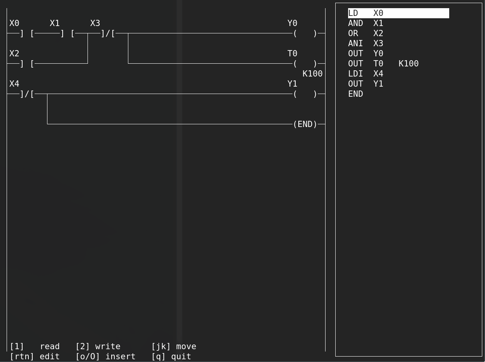

# FX1N assembler and ladder viewer/editor

## Features
- see instruction list (IL) translate into ladder logic
- read programs from FX1N
- write programs to FX1N
- CLI-only program included



## Requirements for ladder.scm (ladder editor)
- CHICKEN scheme
- some basic eggs
- ncurses (port from chicken 5 and patch the "inch" functions)

## Requirement for cli.scm (CLI client)
- CHICKEN scheme
- some basic eggs

## Serial connection
FX1N serial connection is 7 bits with 1 stop bit and even parity. You can set the mode of your serial port with
```
$ stty -F /dev/ttyUSB0 raw -cstopb evenp
```
but this isn't persistent. To save this setting for every time the FX1N is connected write a udev rule like:
```
/etc/udev/rules.d/99-fx1n.rules

SUBSYSTEM=="tty", ATTRS{idVendor}=="067b", ATTRS{idProduct}=="23a3", ACTION=="add", RUN+="/bin/sh -c '/bin/stty -F /dev/%k 9600 raw -cstopb evenp'"
```
where the vendor and product id's are from `lsusb` output for your device.

## Bulding
```
$ csc -s fx1n.scm -j fx1n
$ csc cli.scm
$ csc ladder.scm
```

## CLI
```
cli upload <serial-path> <assembly-file>
cli download <serial-path>
cli assemble <assembly-file>
cli disassemble <hex-string>
cli <assembly-file>
```
e.g.
```
cli upload /dev/ttyUSB0 hi.plc
```
